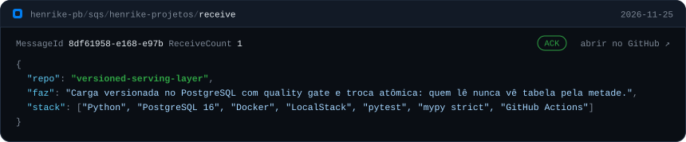
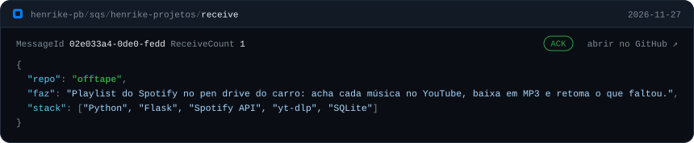
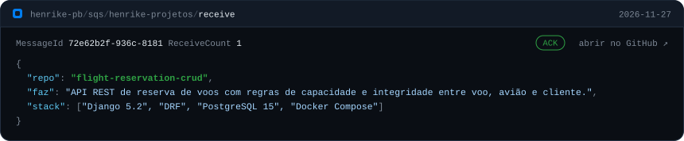

<h3><code>$ airflow dags details henrike</code></h3>

<h3><code>$ clickhouse-client</code></h3>

<h3><code>$ airflow dags show stack</code></h3>

<h3><code>$ dbt build --select henrike</code></h3>

<h3><code>$ aws sqs receive-message --queue-url henrike-projetos</code></h3>

<h3><code>$ airflow dags list-runs contribuicoes</code></h3>

 

[LinkedIn](https://www.linkedin.com/in/henrikebraga/) · [Portfólio](https://henrike-pb.github.io) · [E-mail](mailto:pajaresbragahenrike@gmail.com)

