<h3><code>$ airflow dags details henrike</code></h3>

<h3><code>$ clickhouse-client</code></h3>

<h3><code>$ airflow dags show stack</code></h3>

<h3><code>$ dbt build --select henrike</code></h3>

<h3><code>$ airflow dags list-runs contribuicoes</code></h3>

 

[`versioned-serving-layer`](https://github.com/Henrike-PB/versioned-serving-layer) carga versionada com troca atômica no Postgres ·
[`offtape`](https://github.com/Henrike-PB/offtape) playlist do Spotify em MP3 no pen drive ·
[`flight-reservation-crud`](https://github.com/Henrike-PB/flight-reservation-crud) API REST em Django

 

[LinkedIn](https://www.linkedin.com/in/henrikebraga/) · [Portfólio](https://henrike-pb.github.io) · [E-mail](mailto:pajaresbragahenrike@gmail.com)

